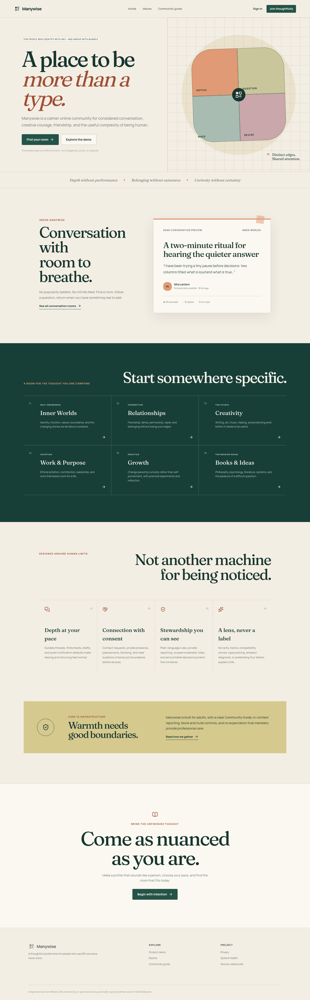
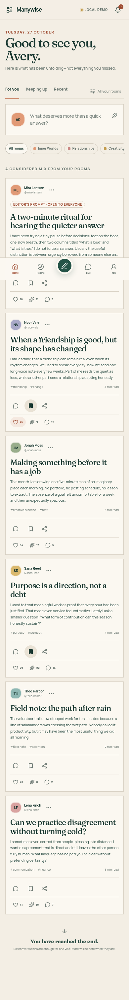
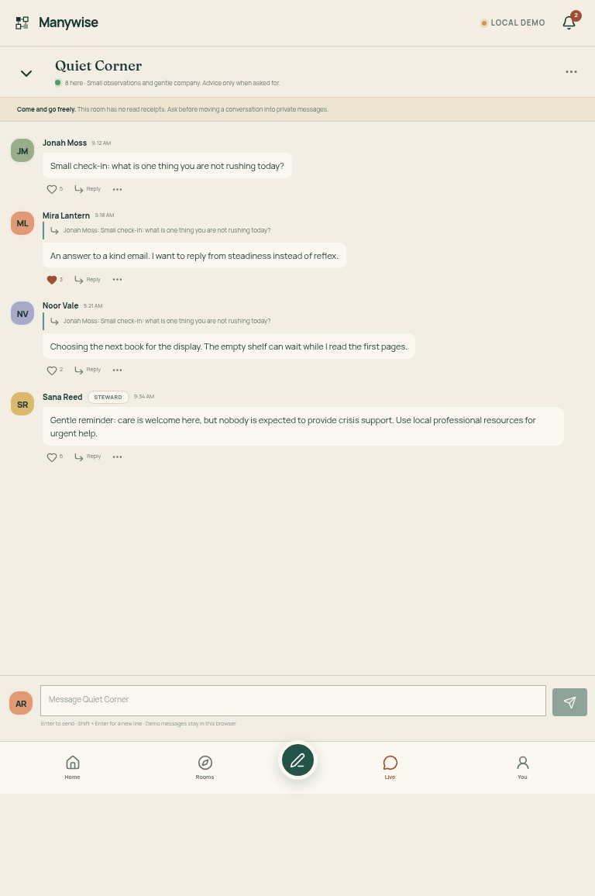

# Manywise

**Come as nuanced as you are.**

Manywise is a production-oriented community product for adults who identify with INFJ and use personality type as a framework for self-reflection—not a diagnosis, compatibility score, or rigid identity. It combines durable discussions, topic rooms, privacy-respecting profiles, finite discovery, realtime chat architecture, and visible safety controls in a distinctive editorial interface.

Manywise is independent and is not affiliated with, endorsed by, or sponsored by The Myers-Briggs Company, the Myers & Briggs Foundation, or any owner of personality-typing trademarks.

## What is implemented

- Branded public homepage, responsive at mobile, tablet, and desktop widths
- Email/password Supabase Auth boundary plus a complete no-credential browser demo
- Three-step onboarding: identity, avatar, interests, goals, pace, privacy, contact, and Community Guide consent
- Finite home feed with room filters, following/recent views, keeps, thread follows, reactions, and honest empty states
- Rich discussion composer with local drafts, image/link attachments, tags, preview, validation, and persisted demo publication
- Eight conversation rooms, room membership, room search/sort, prompts, and room-level live entry
- Thread detail pages with nested reply context, reactions, reporting, sharing, and member controls
- Live-room chat with optimistic local messages, replies, reactions, approximate presence language, typing architecture, mute/leave/report/block controls, offline status, and `BroadcastChannel` cross-tab demo synchronization
- Search across threads, rooms, and members; filters; keyboard shortcut; URL query support; declared-interest discovery
- Privacy-respecting profiles, follows (“keep up”), conversation requests, contributions, visible rooms, and private block/report flows
- Notifications with read/unread state and non-manipulative copy
- Profile, privacy, notifications, theme, export, reset, unblock, sign-out, and local account deletion settings
- Server-gated moderation route with role checks and an auditable, functional steward console
- Full Supabase schema, migration, RLS policies, private authorization helpers, search indexes, Storage policies, realtime publication setup, rate-limit telemetry boundaries, and guarded fictional seed data
- Metadata, manifest, original favicon/mark, generated Open Graph image, sitemap, robots rules, CSP and security headers, loading/error/404 states, reduced-motion behavior, and visible keyboard focus

All fictional activity is explicitly development/demo content. The product makes no claim that a live member base exists.

## Visual preview



<p align="center">
  
  
</p>

## Quick start

Requirements: Node.js 22+ and pnpm 12+.

```bash
cd InfJ
pnpm install
pnpm dev
```

Open [http://localhost:3000](http://localhost:3000). Without environment variables, choose **Explore the demo** or **Join thoughtfully → Create demo profile**. Demo changes persist only in the current browser and can be exported, reset, or deleted in **Settings → Your data**.

Production-style local run:

```bash
pnpm build
pnpm start
```

Validation:

```bash
pnpm typecheck
pnpm lint
pnpm build
# or all three
pnpm verify
```

No large test suite was added; browser journey QA and the generated framework checks are documented in [`docs/verification-report.md`](docs/verification-report.md).

## Stack

- Next.js 16 App Router, React 19, TypeScript in strict mode
- Tailwind CSS 4 toolchain with a purpose-built CSS token and component layer
- Radix UI primitives for dialogs, menus, tabs, switches, and avatars
- Lucide iconography
- Zod validation
- Supabase Auth, PostgreSQL, Storage, and Realtime integration boundary
- Vercel-compatible build and metadata conventions

The interface uses Server Components by default and small Client Component boundaries for interactive surfaces. Demo state is centralized in `ManywiseProvider`; production data access is intended to pass through server-only DAL modules and database RLS.

## Repository map

```text
src/
  app/                     App Router pages, metadata, auth callback, health route
    (app)/                 Authenticated/community shell routes
    actions/               Trusted server actions
  components/
    auth/                   Login and registration experience
    chat/                   Live room experience
    community/              Composer, threads, rooms, profiles, reports
    layout/                 Responsive application shell
    moderation/             Restricted steward console
    providers/              Local demo persistence/realtime state
    settings/               Account, privacy, theme, and data controls
    ui/                     Brand mark and accessible primitives
  lib/
    dal/                    Server-only safe data transfer/auth boundary
    security/               Rate-limit contract and action budgets
    supabase/               Browser/server clients
    demo-data.ts            Clearly fictional demo fixtures
    types.ts                Domain types
    validation.ts           Trusted-boundary schemas
supabase/
  migrations/               Schema, indexes, triggers, grants, RLS, Storage, Realtime
  seed.sql                  Guarded fictional development data
docs/
  research-and-brand-strategy.md
  verification-report.md
```

## Environment

Copy the placeholders and provide project values:

```bash
cp .env.example .env.local
```

| Variable | Exposure | Purpose |
|---|---|---|
| `NEXT_PUBLIC_SUPABASE_URL` | Browser-safe | Supabase project URL |
| `NEXT_PUBLIC_SUPABASE_ANON_KEY` | Browser-safe with RLS | Anonymous/public project key |
| `SUPABASE_SERVICE_ROLE_KEY` | Server only | Trusted jobs and moderator workflows; never import into client code |
| `NEXT_PUBLIC_SITE_URL` | Public | Canonical metadata and redirect origin |
| `UPSTASH_REDIS_REST_URL` / `UPSTASH_REDIS_REST_TOKEN` | Server only | Optional distributed production rate limiter |

Never expose a service-role credential through a `NEXT_PUBLIC_` variable. `.env*` is ignored except `.env.example`.

## Supabase setup

1. Create or link a Supabase project.
2. Apply [`supabase/migrations/202610270001_initial_schema.sql`](supabase/migrations/202610270001_initial_schema.sql) through the Supabase CLI or SQL migration workflow.
3. Confirm `private` is **not** listed as a PostgREST-exposed schema.
4. Confirm RLS remains enabled on every public application table and run allow/deny policy tests with member, steward, unrelated, blocked, and anonymous identities.
5. Configure the site URL and callback URL (`/auth/callback`) in Supabase Auth.
6. Configure email delivery, password policy, abuse controls, and optional MFA before launch.
7. For database-backed demo content only, follow the guarded instructions at the top of [`supabase/seed.sql`](supabase/seed.sql). Create the five `.invalid` fictional Auth users through the supported Auth flow, then rerun the seed. The seed never writes directly to `auth.users`.
8. Configure Realtime only for authorized private channels and test permission revocation/token expiry.
9. Review Storage MIME/size limits in the dashboard in addition to the migration policies.

With the Supabase CLI installed, the common linked-project commands are:

```bash
supabase link --project-ref YOUR_PROJECT_REF
supabase db push
```

Do not run the demo seed against production.

## Security and trust boundaries

- **Server authorization:** every production mutation must re-check authentication, object authorization, suspension, block state, and rate limits inside its Server Action/Route Handler. Layout checks are never sufficient.
- **Database authorization:** grants and RLS provide the durable boundary. Elevated role fields cannot be self-assigned. Report evidence and internal review notes are separated.
- **Moderation:** `/moderation` reads the trusted server viewer and denies ordinary/demo members before rendering controls. Consequential decisions are designed to write immutable audit records.
- **User content:** UI renders text as React text nodes; it does not inject HTML. Attachment production flows require MIME sniffing, image re-encoding, malware handling where relevant, alt-text enforcement, and signed/private delivery.
- **Rate limits:** action budgets live in `src/lib/security/rate-limits.ts`; `rate_limit_events` stores trusted keyed hashes, not raw IPs. A distributed atomic adapter must be configured before enabling production writes.
- **Headers:** CSP, frame denial, content sniffing protection, conservative referrer policy, and restricted browser permissions are set in `next.config.ts`.
- **Privacy:** no read receipts, profile-view tracking, public follower counts, compatibility scoring, or hidden behavioral-interest inference.
- **Crisis content:** reporting offers a safety-concern path and immediate-resource language. Manywise is not healthcare or an emergency service.

See [`docs/research-and-brand-strategy.md`](docs/research-and-brand-strategy.md) for threat assumptions, community rules, sources, and product rationale.

## Accessibility

The implementation targets WCAG 2.2 AA where practical: semantic landmarks/headings, labeled controls, keyboard paths, focus restoration in Radix dialogs, high-contrast visible focus, 390px reflow, generous touch targets, status announcements, no color-only primary states, and `prefers-reduced-motion`. Authentication permits password managers and copy/paste. Production launch still requires testing with disabled participants and real assistive technologies, not only automated snapshots.

## Deployment to Vercel

1. Import the repository into Vercel.
2. Set the environment variables for Production and Preview separately.
3. Set `NEXT_PUBLIC_SITE_URL` to the canonical HTTPS origin.
4. Add matching Supabase Auth redirect URLs for production and preview domains.
5. Deploy using the default Next.js build command (`pnpm build`).
6. Run migration/policy checks before routing production traffic.
7. Add error monitoring with user-content redaction, backup/restore rehearsals, abuse operations, and incident response ownership.

## Known limitations

The application is deliberately complete as a local product demo while external credentials are absent. These items must be finished and operationally tested before public launch:

- The polished social experience currently reads/writes `localStorage`; production social mutations and queries must be wired to the supplied Supabase schema/DAL and tested against RLS.
- Supabase email/password actions and callback are implemented, but a cloud-authenticated session is not yet hydrated into the local product provider.
- Realtime production tables/policies are defined; the credential-free UI uses browser `BroadcastChannel` and local optimistic state rather than claiming multi-user delivery.
- Production uploads need signed URLs, server validation/re-encoding, quotas, and content-safety operations. Demo images are size-capped browser data URLs.
- Distributed rate-limit credentials/adapter, transactional notification fan-out, email/push delivery, production account export/deletion jobs, moderation staffing/appeals, legal/privacy review, and observability are deployment responsibilities.
- The Manywise name passed a basic web confusion screen, not formal trademark clearance.

These limitations are surfaced honestly in the interface where relevant; unavailable cloud behavior is never presented as live.

## Research and verification

- [`docs/research-and-brand-strategy.md`](docs/research-and-brand-strategy.md): sources, user needs, competitor patterns, risks, brand system, terminology, trust/safety, and design decisions
- [`docs/verification-report.md`](docs/verification-report.md): commands, browser journey, viewport checks, fixes, console/network results, and screenshot paths
